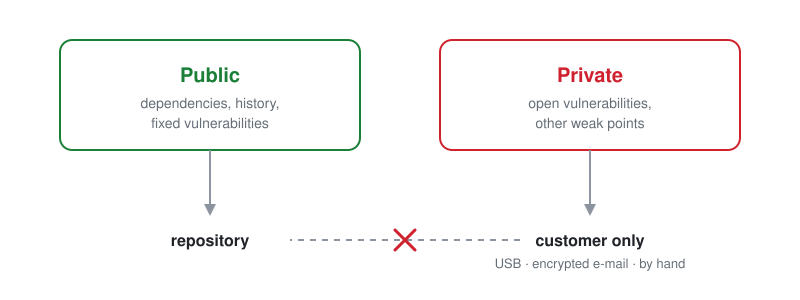
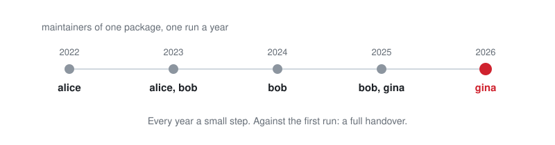

<div align="center">

<a href="https://remaker.ch">
  <picture>
    <source media="(prefers-color-scheme: dark)" srcset="https://remaker.ch/brand/remaker-logo-beyaz.png">
    
  </picture>
</a>

# LifeLine

<p>A Claude Code skill that finds everything your project depends on from the outside, and keeps watching the code you copied in.</p>

<p><b>Version 1.0.4</b></p>

</div>

## Why

While you build a project you pull in libraries, forks and ready-made snippets. Then the project ships, and from that day on every problem in the borrowed code is your problem: a security hole, a package that disappears, a maintainer who walks away or hands the keys to a stranger.

LifeLine finds the dead, broken and ownerless code your project rests on: packages nobody maintains anymore, packages whose maintainer changed, packages whose maintainer nobody can name. Then it helps you act on them: replace one with a built-in, copy in only the part you use, or keep it and watch it.

**Run it regularly.** Dependencies change after you stop looking. A package that was healthy on delivery day can be abandoned, handed over or compromised a year later, and nothing in your repo changes when that happens. Run LifeLine before every release and on a schedule, monthly for example. Each report has a section on what changed since the last one.

## Two stories

**left-pad, 2016.** A developer lost a naming dispute with a company over an npm package and, in protest, removed every package on their account, 273 of them. One was `left-pad`, 11 lines that pad a string on the left. Thousands of projects depended on it without knowing, through a dependency of a dependency. Babel and React builds broke worldwide within hours. npm restored the package, which it had never done before, and changed its rules so a package others depend on can no longer simply be removed.

**xz Utils, 2024.** `xz` is a compression library found in nearly every Linux system, kept for years by one volunteer. In 2021 a contributor calling themselves "Jia Tan" started sending helpful patches. Over two years, while other accounts publicly pressured the tired maintainer to hand over the work, Jia Tan earned trust and the right to publish releases. In February 2024 versions 5.6.0 and 5.6.1 shipped with a backdoor hidden in test files and the build script, built to let an attacker into servers through SSH. It was found by chance a month later, when Andres Freund, an engineer at Microsoft, chased a half-second delay in SSH logins. By then it was already in test versions of Fedora, Debian and other distributions, weeks away from millions of servers ([CVE-2024-3094](https://nvd.nist.gov/vuln/detail/CVE-2024-3094), severity 10 out of 10). The same thing had happened before on npm: in 2018 the tired maintainer of `event-stream`, with about two million downloads a week, handed it to a volunteer who added a dependency that stole from a Bitcoin wallet app.

LifeLine would not have found the xz backdoor; no tool did. What it does is show you, before something like that happens, which of your dependencies rest on one tired person, haven't had a release in years, or have just changed hands.

## What it does

- **Maps** every outside dependency: packages (declared and actually imported), CI actions, Docker images, CDN assets, external services.
- **Checks upstream health:** last release, deprecation, archived repository, number of maintainers, install-time scripts.
- **Measures the real cost** of a package: total lines, lines actually reachable, how many other packages it pulls in, which of its functions you call.
- **Points to built-ins first:** `left-pad` → `padStart`, `rimraf` → `fs.rm`. Deleting a dependency beats copying it.
- **Vendors only what you use**, after a mandatory license gate (copyleft is never recommended), and only with your approval.
- **Tracks vendored code** in a `VENDORED.md` ledger: upstream updates, known CVEs ([osv.dev](https://osv.dev)), and a checksum that catches any change to the copy.
- **Helps patch it:** when upstream fixes something, it diffs the old and new version against your copy and proposes the patch.
- **Keeps the dangerous part private:** open vulnerabilities and weak points go to a separate report that never enters git. Closed vulnerabilities are published, with the dates they were found and fixed.

It audits, measures and advises. It changes your project only when you say yes.

## Install

For all your projects:

```sh
git clone https://github.com/reporemaker/LifeLine ~/.claude/skills/lifeline
```

For one project, shared with the team through the repo:

```sh
git clone https://github.com/reporemaker/LifeLine .claude/skills/lifeline
```

Update later with `git -C ~/.claude/skills/lifeline pull` (or the project path).

## Use

```
/lifeline            # full audit
/lifeline map        # context map only
/lifeline deps       # map + external code inventory
/lifeline services   # map + external services
/lifeline vendored   # vendor ledger check only
```

Claude also picks the skill up on its own when you ask things like *"list this project's dependencies"* or *"is our vendored code still safe?"*.

## Reports and history

Everything goes into a `LifeLine_Report/` folder at the project root. The folder keeps the history, and it is split in two:

<p align="center"></p>

```
LifeLine_Report/
├── .gitignore                    "private/" - written by LifeLine
├── dependency-report.md          latest full report
├── baseline-2026-10-24.md        first full report, kept for good
├── timeline.md                   every dependency's changes across all runs
├── changes/2026-11-24-changes.md what changed in that run, important items only
├── state/2026-11-24.tsv          snapshot of each run
└── private/                      NEVER on GitHub
    ├── sensitive-report.md       open vulnerabilities and weak points
    └── …                         its baseline, changes, timeline and snapshots
```

**Public part.** The latest report is always complete. Each later run also writes a short change report: what needs attention, what changed since the previous run, what is different from the first report, and changes that build up over many runs. A library maintained by *A* four years ago and by *G* today shows up as every step in between, not as one surprise:

<p align="center"></p>

Vulnerabilities that have been fixed are listed with the dates they were found and closed. Commit this part and the history travels with the repo.

**Private part.** Open vulnerabilities, what breaks when a service disappears, how backups and secrets are handled, which tools run unpinned code. None of it is a leak on its own; together it reads like a map of where an attack would hurt most. So it stays in `private/`, which LifeLine keeps out of git, and the public report says nothing about it, not even how many items it holds. It goes to the customer only, outside GitHub: on a USB stick, by encrypted e-mail, or by hand. The public report ends with the date and a sha256 hash of it, so the customer can check that the file they received is the one from that run.

**A note for public repositories.** If your lock file is public, anyone can run `npm audit` on it and find your open dependency advisories without the private report. The private part does not hide those; fixing them does. What it does keep private is what no file in the repo reveals (backups, secrets, access, deploy paths) and the ready-made list of where to strike first.

## Example output

[ChessRun](https://github.com/reporemaker/ChessRun) is an open-source game whose `LifeLine_Report/` folder is public, as a real example: **[ChessRun/LifeLine_Report](https://github.com/reporemaker/ChessRun/tree/main/LifeLine_Report)**. It holds the full report with the 21 vulnerabilities found and fixed on the first day, the baseline, a change report, the timeline and the snapshots.

> [!WARNING]
> **Never put your `private/` folder on GitHub**, not in a public repository and not in a private one. It goes to the customer only, outside GitHub: USB stick, encrypted e-mail, or by hand.
>
> ChessRun shows the format in a separate folder, `private_test/sensitive-report.EXAMPLE.md`, committed on purpose. **All of its data is fake.** Its real `private/` folder is not in the repository. ChessRun's real sensitive report has never been in the repository.

## Notes

- **No dependencies of its own.** Plain bash (macOS 3.2 compatible) and standard Unix tools. `curl`, `node` and `python3` make it see more, but are optional.
- **Works offline.** Remote checks are skipped and the report says so. A skipped check is never shown as "current".
- **Static analysis has limits.** Dynamic imports are not traced, and "reachable lines" are counted per file. Every report has a "Limits of This Analysis" section.
- **History needs npm lock files and `node` for now.** The snapshots behind the change reports and the timeline read `package-lock.json` with `node`. Other ecosystems are still audited, but listed as a limit in the history.
- **GitHub rate limit.** Upstream checks use GitHub's API without a token (60 requests an hour). Set `GITHUB_TOKEN` for larger projects.
- **Reports in your language.** Section names and file names stay English; the prose follows the language you write in.

## License

[MIT](LICENSE)

---

[RE\*maker](https://remaker.ch) // SEU/Emekulas
